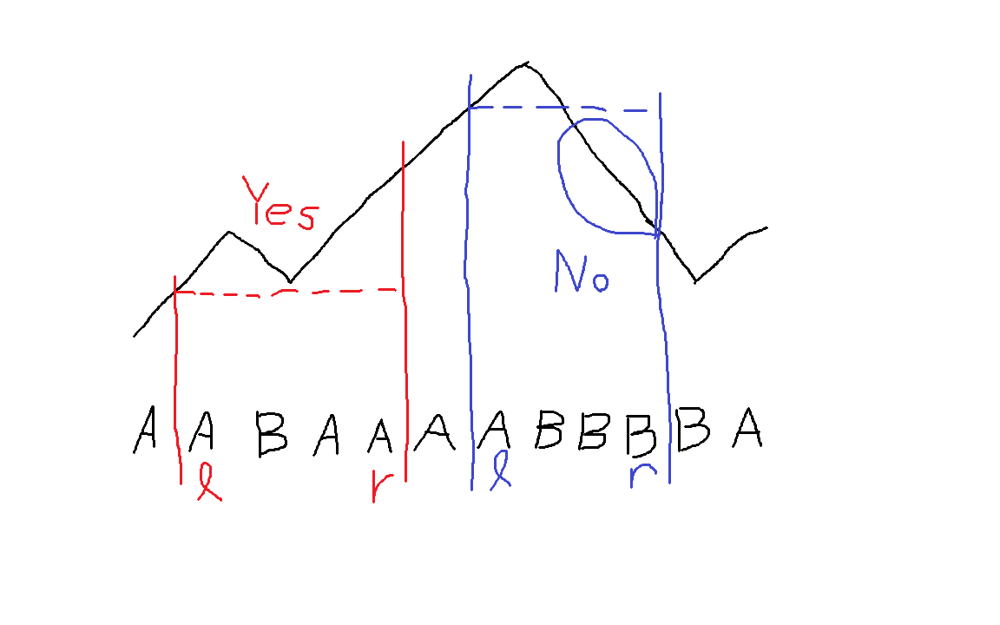

[前回の参加記（ABC472回）](https://wcpc.pages.dev/activities/abc472-log/)

## はじめに

こんにちは。**ShoboiNamae**です。

甲子園が終わってしまいました。智辯和歌山強かったですね。

ABCの方はどうかというと、せっかく初めてF問題を解けたのにEが解けなかったので、初6完はお預けとなってしまいました。

## 結果サマリ

- [ABC473](https://atcoder.jp/contests/abc473)
- WCPC参加人数: **5人**
- 各問題の最速解答者（実AC時刻）:

| 問題 | 参加者名      | タイム | 言語                       |
| :--- | :------------ | :----- | :------------------------- |
| A    | nsubaru       | 0:26   | Java24 (OpenJDK 24.0.2)    |
| B    | Caffeineholic | 2:41   | Python (PyPy 3.11-v7.3.20) |
| C    | Caffeineholic | 5:39   | Python (PyPy 3.11-v7.3.20) |
| D    | nsubaru       | 17:22  | Java24 (OpenJDK 24.0.2)    |
| E    | nsubaru       | 52:10  | Java24 (OpenJDK 24.0.2)    |
| F    | ShoboiNamae   | 89:18  | C++23 (GCC 15.2.0)         |
| G    | -             | -      | -                          |

## 今週の出題

### ABC473-A

[問題ページ](https://atcoder.jp/contests/abc473/tasks/abc473_a)

<details>

<summary>問題文を表示</summary>

<div style="background-color: #f5f5f5; padding: 15px; border-radius: 5px; border: 1px solid #ddd;">

**問題文**

長さ $N$ の整数列 $A = (A_1, A_2, \dots, A_N)$ が与えられます。ここで、$N$ は偶数です。

$A$ の後半部分の総和、つまり、$A_{(N / 2) + 1}, A_{(N / 2) + 2}, \dots, A_{N}$ の総和を求めてください。

**制約**

- 入力は全て整数
- $N$ は $2 \le N \le 100$ を満たす偶数
- $1 \le A_i \le 100$

**入力**

入力は以下の形式で標準入力から与えられる。

$N$<br />
$A_1$ $A_2$ $\dots$ $A_N$<br />

**出力**

答えを出力せよ。

</div>

</details>

問題文の通り、$A_{(N / 2) + 1}$ 以降の値を足せばよいです。

`for` ループを $1$ から $N$ までにすると問題文の添え字と揃うので条件文が書きやすいと思います。

### ABC473-B

[問題ページ](https://atcoder.jp/contests/abc473/tasks/abc473_b)

<details>

<summary>問題文を表示</summary>

<div style="background-color: #f5f5f5; padding: 15px; border-radius: 5px; border: 1px solid #ddd;">

**問題文**

高橋くんは、現在 $N$ 枚のカードを持っています。
$i$ 番目 $(1 \le i \le N)$ のカードには整数 $A_i$ が書かれています。

高橋くんは、以下の操作を可能な限り繰り返します。

- 同じ整数が書かれている異なる 2枚のカードを選び、それら 2枚のカードを食べる。食べたカードは永久に取り除かれ、以降の操作で選ぶことはできない。

操作ができなくなったときに残っているカードに書かれている整数の合計を求めてください。

**制約**

- $1 \le N \le 100$
- $1 \le A_i \le 100 \; ( 1 \le i \le N )$
- 入力はすべて整数

**入力**

入力は以下の形式で標準入力から与えられる。

$N$<br />
$A_1$ $A_2$ $\cdots$ $A_N$<br />

**出力**

残ったカードに書かれている整数の合計を出力せよ。

</div>

</details>

まず `map` などで各整数が何回出てくるか数えます。数え終わったら奇数回登場したの数字だけ足し合わせると答えが求まります。

### ABC473-C

[問題ページ](https://atcoder.jp/contests/abc473/tasks/abc473_c)

<details>

<summary>問題文を表示</summary>

<div style="background-color: #f5f5f5; padding: 15px; border-radius: 5px; border: 1px solid #ddd;">

**問題文**

現在 AtCoder 高校には $K$ 個のクラスと $N$ 人の生徒が存在し、$i$ 人目 $( 1 \le i \le N )$ の生徒は $A_i$ 番目のクラスに所属しています。

高橋くんは 9月から AtCoder 高校に転入することになりました。
高橋くんは、転入する際に $K$ 個のクラスの中から好きなクラスを $1$ つ選び、そのクラスに所属することができます。

高橋くんは、自分が所属しているクラスより多い人数が所属しているクラスがあるとき悲しみ、そうでないとき喜びます。

所属したときに高橋くんが喜ぶクラスがいくつあるか求めてください。

**制約**

- $1 \le N \le 2 \times 10^5$
- $1 \le K \le N$
- $1 \le A_i \le K \; ( 1 \le i \le N )$
- 入力はすべて整数

**入力**

入力は以下の形式で標準入力から与えられる。

$N$ $K$<br />
$A_1$ $A_2$ $\ldots$ $A_N$<br />

**出力**

条件を満たすクラスの個数を出力せよ。

</div>

</details>

高橋君が所臆して喜ぶ可能性があるクラスは人数が最大のクラスと、$(\text{（人数の最大）} - 1)$ 人が所属するクラスです（高橋君が所属すると人数が $1$ 増えるため）。よって、それらのクラスを数えればよいです。

実装はまず各クラスの人数を配列で求めて、B問題のように `map` でkeyを人数、値をその人数のクラスの数とすれば楽に数えられます。

C++だと `map` はkeyの昇順に並んでいるので、最後の要素は `mp.rbegin()->first` でkeyを、 `mp.rbegin()->second` で値を取得できます。 `mp.rbegin()` を `(++mp.rbegin())` にすると最後から2番目を取得できます。注意点として、各クラスの生徒数のバリエーションが1つだった場合に最後から2番目を見ようとするとエラーになるので場合分けする必要があります。

### ABC473-D

[問題ページ](https://atcoder.jp/contests/abc473/tasks/abc473_d)

<details>

<summary>問題文を表示</summary>

<div style="background-color: #f5f5f5; padding: 15px; border-radius: 5px; border: 1px solid #ddd;">

**問題文**

非負整数からなる長さ $N$ の列 $ A = (A_1, A_2, \ldots, A_N)$ であって、$\displaystyle\sum_{i = 1}^N i \times A_i = K$ を満たすものを辞書順で小さいほうからすべて出力してください。

ここで、条件を満たす数列が $ 3 \times 10^5$ 個以下であるような入力のみが与えられます。

<details>

<summary>数列の辞書順とは？</summary>

数列 $S = (S_1, S_2, \ldots, S_{|S|})$ が数列 $T = (T_1, T_2, \ldots, T_{|T|})$ より**辞書順で小さい**とは，下記の 1. と 2. のどちらかが成り立つことを言います．
ここで，$|S|,  |T|$ はそれぞれ $S, T$ の長さを表します．

1.$|S| \lt |T|$ かつ $(S_1, S_2, \ldots, S_{|S|}) = (T_1, T_2, \ldots, T_{|S|})$．
1.  ある整数 $1 \leq i \leq \min\lbrace |S|,  |T| \rbrace$ が存在して，下記の $2$ つがともに成り立つ．

- $(S_1, S_2, \ldots, S_{i-1}) = (T_1, T_2, \ldots, T_{i-1})$
- $S_i$ が $T_i$ より（数として）小さい．

</details>

**制約**

- $1 \le N \le 10$
- $1 \le K \le 2 \times 10^5$
- 条件を満たす数列は $3 \times 10^5$ 個以下
- 入力はすべて整数

**入力**

入力は以下の形式で標準入力から与えられる。

$N$ $K$<br />

**出力**

条件を満たす非負整数列が $q$ 個あるとして、$q$ 行にわたって出力せよ。
それぞれの行には条件を満たす非負整数列の要素を空白を区切りとして順に出力せよ。
どの数列についても、その数列より前に出力された数列はどれもその数列より辞書順で小さくなければならない。

</div>

</details>

ぱっと見難しい数学の問題に見えますが、答えは $3 \times 10^5$ 以下であることや、$1 \le N \le 10$ から何か簡単な解き方がありそうな雰囲気が出ています。$N$ が小さいのでビット全探索や配列全列挙の予感もしますが...

よく考えると、$N$ 重ループを回せば解けそうです。答えが小さいことが確約されているので無駄がない全探索は間に合います。$A_1$ の値を `i` 、$A_2$ の値を `j` 、$A_3$ の値を `k` ... とすれば、

```cpp
for (int i = 0; true; i++) {
  if (i * 1 > K) break;
  if (N == 1) {
    int tmp = K;
    if (tmp % 1 == 0) cout << tmp / 1 << endl;
    break;
  }
  for (int j = 0; true; j++) {
    if (i * 1 + j * 2 > K) break;
    if (N == 2) {
      int tmp = K - i * 1;
      if (tmp % 2 == 0) cout << i << ' ' << tmp / 2 << endl;
      break;
    }
    for (int k = 0; true; k++) {
      if (i * 1 + j * 2 + k * 3 > K) break;
      if (N == 3) {
        int tmp = K - i * 1 - j * 2;
        if (tmp % 3 == 0) cout << i << ' '  << j << ' ' << tmp / 3 << endl;
        break;
      }

      ...
    }
  }
}
```

こんな感じのコードを書けば解くことができそうです。[10重ループでD問題が解けたらロマンチックですね（？）](https://atcoder.jp/contests/abc473/submissions/80405027)

実際は10重ループなんてバグ取りが無理ゲーと化すのでやめた方がいいです。通常、$N$ によって `for` の重ねる数が変わる場合は再帰関数が有効です。上の `for` ループも、中身はほぼ同じ構造をしているので1つの関数に書き直せます。

```cpp
// N,  K はグローバル変数にする
// ans は長さNの配列
void rec(int layer,  int sum,  vector<int> &ans)
{
  for (int a = 0; true; a++) {
    if (sum + a * layer > K) break;
    if (N == layer) {
      int tmp = K - sum;
      if (tmp % layer == 0) {
        ans[layer - 1] = tmp / layer;
        for (int idx = 0; idx < N; idx++) {
          if (idx != 0) cout << ' ';
          cout << ans[idx];
        }
        cout << endl;
      }
      break;
    }
    ans[layer - 1] = a;
    rec(layer + 1,  sum + a * layer,  ans);
  }
}
```

再帰関数で書くと答えを出力する部分が複雑になってしまいますが、多重ループを書くよりは短く書くことができます。

### ABC473-E

[問題ページ](https://atcoder.jp/contests/abc473/tasks/abc473_e)

<details>

<summary>問題文を表示</summary>

<div style="background-color: #f5f5f5; padding: 15px; border-radius: 5px; border: 1px solid #ddd;">

**問題文**

非負整数からなる長さ $N$ の列 $A = (A_1, A_2, \ldots, A_N)$ が与えられます。

非負整数列からなる長さ $1$ 以上の列 $S = (S_1, S_2, \ldots, S_k)$ の**スコア**を、列 $S_i ( 1 \le i \le k)$ のうち要素の総和が $K$ で割り切れるものの個数として定めます。

$A$ を $1$ つ以上の連続する部分列に分割して得られる非負整数列の列に対するスコアの最大値を求めてください。
ここで、長さ $N$ の列 $A$ を $1$ つ以上の連続する部分列に分割するとは、整数からなる長さ $1$ 以上の列 $l = (l_1, l_2, \ldots, l_k) ( 1 = l_1 \lt l_2 \lt \cdots \lt l_k \le N)$ をとり、以下のような $k$ 個の列を作ることをいいます。

- $(A_{l_i}, A_{l_i+1}, \ldots, A_{l_{i + 1} - 1}) (1 \le i \le k)$（ここで、$l_{k + 1} = N + 1$ とする。）

**制約**

- $1 \le N \le 2 \times 10^5$
- $1 \le K \le 10^9$
- $0 \le A_i \lt K$
- 入力はすべて整数

**入力**

入力は以下の形式で標準入力から与えられる。

$N$ $K$<br />
$A_1$ $A_2$ $\ldots$ $A_N$<br />

**出力**

答えを出力せよ。

</div>

</details>

コンテスト中は一見してよく分からなかったので飛ばしましたが、総和が `K` で割り切れる区間を求めて区間スケジューリングをすれば解けます。

総和が $K$ の区間を求めるためにはまず $A$ の累積和を取ります。そして累積和の配列の要素をすべて $K$ で割ったあまりに置換します。そうすると、あまりが等しい2つの要素を選べば総和が $K$ で割り切れる区間になります。

と考え方は意外と単純なのですが、適当にコーディングするとMLEとかREとかが出ました。（長さ $K$ の配列を作るのが悪い）

ちゃんと制約は読みましょう。そして `vector` は信じない。信じられるのは `map` だけ。（諸説あります）

### ABC473-F

[問題ページ](https://atcoder.jp/contests/abc473/tasks/abc473_f)

<details>

<summary>問題文を表示</summary>

<div style="background-color: #f5f5f5; padding: 15px; border-radius: 5px; border: 1px solid #ddd;">

**問題文**

長さ $N$ の `A`, `B` からなる文字列 $S$ が与えられます。

以下のクエリを合計 $Q$ 個処理してください。

$1$ $i$ $c$<br />

タイプ1: $S$ の $i$ 文字目を $c$ に変更する。

$2$ $l$ $r$<br />

タイプ2:

文字列 $T$ を、現在の文字列 $S$ の $l$ 文字目から $r$ 文字目までを抜き出した文字列とする。

文字列 $T$ が以下の操作で得られる文字列であれば `Yes` 、そうでなければ `No` と出力する。

- 空文字列から始め、以下の $2$ つの操作を好きな順序で 0回以上何回でも行う。

  - 文字列の（先頭・末尾を含めた）任意の箇所を選択し、そこに `A` を挿入する。
  - 文字列の（先頭・末尾を含めた）任意の箇所を選択し、そこに `AB` を挿入する。

**制約**

- $N$ は $1 \le N \le 5 \times 10^5$ を満たす整数
- $S$ は `A`, `B` からなる長さ $N$ の文字列
- $Q$ は $1 \le Q \le 2 \times 10^5$ を満たす整数
- 与えられるクエリはタイプ $1, 2$ のいずれかである
- タイプ1のクエリは以下の制約を満たす

  - $i$ は $1 \le i \le N$ を満たす整数
  - $c$ は `A`, `B` のいずれか

- タイプ2のクエリは以下の制約を満たす

  - $l, r$ は $1 \le l \le r \le N$ を満たす整数

**入力**

入力は以下の形式で標準入力から与えられる。

$N$<br />
$S$<br />
$Q$<br />
${\rm Query}_1$<br />
${\rm Query}_2$<br />
$\vdots$<br />
${\rm Query}_Q$<br />

但し、${\rm Query}_i$ は $i$ 個目のクエリを表し、クエリの入力は問題文中の形式に従う。

**出力**

タイプ2のクエリが入力されるごとに、答えを $1$ 行に出力せよ。

</div>

</details>

遅延セグ木ゲーでございます。遅延セグ木持ち以外お断りゲームです。

もちろん私が遅延セグ木を持っているわけがないし、仕組みをよく理解していないので自力で実装することもできません。ただ、遅延セグ木を使えば区間加算ができることだけは知っていました。そして、割と早い段階で遅延セグ木があれば解けそうなことが分かりました。

そこから、まずインターネットから遅延セグ木の実装を持ってきます。そして、持ってきた遅延セグ木の値の更新用関数が「区間内の要素をすべて `x` に変える」というものだったので、それを試行錯誤して「区間内の要素すべてに `x` 足す」という振る舞いをするように変えました（ちゃんと実装できているのかは未だに分からない）。

そしてその魔改造遅延セグ木を使って気合いで頑張った結果、なんとかコンテスト中に通すことができました。

<details style="padding: 15px; border-radius: 5px; border: 1px solid #ddd;">
<summary>ざっくり解法</summary>
2番目のクエリについて考えると、Yesとなる条件は「区間内で `A` が `B` より多いこと」です。そこで、 `A` で $+ 1$、 `B` で $- 1$ される折れ線グラフ的なものを考えます。



上の画像のようなイメージです。 `Yes` となる区間は、区間の左端の高さよりも低くなる箇所が区間に存在せず（画像の左側の区間）、 `No` となる区間は低くなる箇所が存在します（画像の右側の区間）。

これはRMQ（区間最小を求めるクエリ）に対応したセグメント木を使えば、$(\text{（区間の最小値）} - \text{（区間の左端の値）})$ が $0$ 以上かどうかによって判定できます。

また、クエリ1で文字が変わったとき、 `A` から `B` に変わったならそれ以降の要素全てから $2$ を引きます。 `B` から `A` に変わったならそれ以降の要素全てに $2$ を足します。

以上を適切に実装すれば解くことができます。

</details>

## 最後に

この日からちゃんとセグ木を勉強しようと思っていますが、未だに理解していないのでそろそろ向き合おうと思いました。
