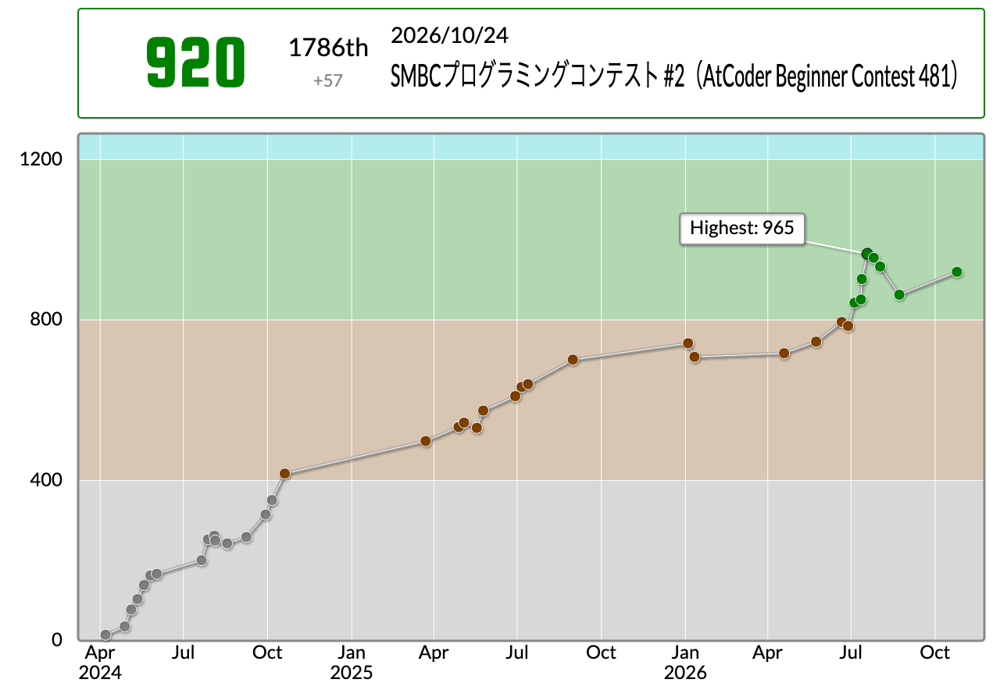

[前回の参加記(ABC480)](/activities/abc480-log)

## はじめに

おはようございます（3か月ぶりの起床）。

同期や後輩たちに「代表ならコンテストに出ろよ。処しますよ（大意訳）。」と言われたので、25k円目当てで出ました。

結果として、1ペナでA〜Eの5完。大勝ちできてよかったです。



前回は、Unratedのつもりで参加したのにRatedになっていたという大規模人災で、レートが爆下げでした。今回は、まぁ、おおかた戻せたかなと。本当に気を付けないといけませんよ。

「自分はそんなことしないよw。」って方。

**します**。

---

体感では、難易度は

`A` \< `C` \<\< `D` \< `B` \<\<\< `E`... という感じでした。

明らかに今回はA〜Dまでが簡単セットだったので、ちゃんと解き切れてよかったです。偏角ソートや、なぜか整備していた幾何ライブラリも活かせました。

---

## 結果サマリ

- [ABC481](https://atcoder.jp/contests/abc481)
- WCPC参加人数: **6人**
- 各問題の最速解答者（実AC時刻）

| 問題 | 参加者名      | タイム | 言語                       |
| :--- | :------------ | :----- | :------------------------- |
| A    | nsubaru       | 0:23   | Java24 (OpenJDK 24.0.2)    |
| B    | ShoboiNamae   | 3:47   | C++23 (GCC 15.2.0)         |
| C    | ShoboiNamae   | 6:17   | C++23 (GCC 15.2.0)         |
| D    | Caffeineholic | 17:22  | Python (PyPy 3.11-v7.3.20) |
| E    | Twil3         | 94:46  | Rust (rustc 1.89.0)        |
| F    | -             | -      | -                          |
| G    | -             | -      | -                          |

## 今週の出題

### ABC481-A

[問題ページ](https://atcoder.jp/contests/abc481/tasks/abc481_a)

<details>

<summary>問題文を表示</summary>

<div style="background-color: #f5f5f5; padding: 15px; border-radius: 5px; border: 1px solid #ddd;">

**問題文**

$1$ 以上 $9$ 以下の整数 $A, B$ が与えられます。

$A+B$ の値の桁数を求めてください。

**制約**

- $A, B$ は $1$ 以上 $9$ 以下の整数

**入力**

入力は以下の形式で標準入力から与えられる。

$A$ $B$<br />

**出力**

答えを出力せよ。

</div>

</details>

さて、簡単枠です。天下のPython様なら、

```python
len(str(a+b))
```

で答えが出ます。Rust君でも文字列に変換して長さを求められます。整数のまま計算するなら、

```rust
(a+b).ilog10() + 1
```

が手っ取り早いと思います。いつも `+1` が必要なのか悩みます。普通に考えたら、いるんですけどね。

### ABC481-B

[問題ページ](https://atcoder.jp/contests/abc481/tasks/abc481_b)

<details>

<summary>問題文を表示</summary>

<div style="background-color: #f5f5f5; padding: 15px; border-radius: 5px; border: 1px solid #ddd;">

**問題文**

$xy$ 平面上に $1, 2, \ldots, N$ の番号が付けられた $N$ 個の点があり、点 $i$ の座標は $(i, A_i)$ です。

$i = 1, 2, \ldots, N-1$ について点 $i$ と点 $i+1$ を線分で結び、1本の折れ線を作ります。

この折れ線上（端点も含む）にある点のうち、$y$ 座標が $K$ であるものの個数を求めてください。

ただし、制約より条件を満たす点の個数は有限であることが保証されます。

**制約**

- $2 \le N \le 100$
- $1 \le A_i \le 100$ $(1 \le i \le N)$
- $A_i \ne A_{i+1}$ $(1 \le i < N)$
- $1 \le K \le 100$
- 入力される値はすべて整数

**入力**

入力は以下の形式で標準入力から与えられる。

$N$ $K$<br />
$A_1$ $A_2$ $\ldots$ $A_N$<br />

**出力**

折れ線上にある点のうち、$y$ 座標が $K$ であるものの個数を出力せよ。

</div>

</details>

嫌いです。

ここでは配列を0始まりとします。各線分の内部で高さ $K$ をまたぐ点と、高さがちょうど $K$ の頂点を分けて数えます。

配列 $A$ の末尾に $A[N-1]$ と同じ値を番兵として追加し、$i = 0, 1, \ldots, N-1$ について、

- $A[i] = K$
- $A[i] < K < A[i+1]$
- $A[i] > K > A[i+1]$

のいずれかの条件を満たした回数が答えとなります。番兵を追加すると、最後の頂点も同じループで数えられます。番兵との間では高さ $K$ をまたがないので、余計な交点は数えません。

### ABC481-C

[問題ページ](https://atcoder.jp/contests/abc481/tasks/abc481_c)

<details>

<summary>問題文を表示</summary>

<div style="background-color: #f5f5f5; padding: 15px; border-radius: 5px; border: 1px solid #ddd;">

**問題文**

コワスギ銀行の裏庭では、幽霊がカボチャを育てています。あなたはカボチャたちに銀行口座を開設してあげることにしました。

カボチャ用銀行口座には、開設時に名前と ID を 1個ずつ割り当てます。ID の値を選ぶときは、まだ ID として使われていない正の整数のうち最小のものを採用します。

はじめ、カボチャ用銀行口座はひとつも開設されていません。以下の出来事が $Q$ 回起きるので、順に処理してください。

- カボチャがやってきて、名前 $s$ を名乗る。

  - 名前 $s$ が割り当てられた口座が存在する場合、その ID を出力する。
  - 名前 $s$ が割り当てられた口座が存在しない場合、名前 $s$ の口座を新規に 1個開設し、その ID を出力する。

**制約**

- $Q$ は $1$ 以上 $2 \times 10^5$ 以下の整数
- 各出来事において、$s$ は英小文字からなる長さ $1$ 以上 $10$ 以下の文字列

**入力**

入力は以下の形式で標準入力から与えられる。

$Q$<br />
$\mathrm{query}_1$<br />
$\vdots$<br />
$\mathrm{query}_Q$<br />

$\mathrm{query}_i$ は $i$ 回目の出来事を表し、以下の形式で与えられる。

$s$<br />

**出力**

$Q$ 行出力せよ。$i$ 行目には、$i$ 回目の出来事で出力するべき値を出力せよ。

</div>

</details>

`HashMap`（Pythonでは `dict`）を使えばいいです。

### ABC481-D

[問題ページ](https://atcoder.jp/contests/abc481/tasks/abc481_d)

<details>

<summary>問題文を表示</summary>

<div style="background-color: #f5f5f5; padding: 15px; border-radius: 5px; border: 1px solid #ddd;">

**問題文**

$N$ 個の惑星と $M$ 本の航路があります。惑星には $1$ から $N$ までの、航路には $1$ から $M$ までの番号が付けられています。

航路 $i$ は惑星 $A_i$ から惑星 $B_i$ へと結ばれています。各航路は一方通行です。

この空間において、宇宙船は以下の $2$ 種類の操作を行うことができます。

- 今いる惑星から航路が直接結ばれた惑星のうち、番号が最小の惑星に、燃料を消費せずに移動する。
- 今いる惑星から航路が直接結ばれた惑星を好きに選び、燃料を $1$ 消費して選んだ惑星に移動する。

宇宙船が惑星 $S$ から出発して惑星 $T$ に到着するまでに消費する燃料の量の最小値を求めてください。到達が不可能な場合は代わりに $-1$ を出力してください。

**制約**

- $2 \leq N \leq 2 \times 10^5$
- $1 \leq M \leq 2 \times 10^5$
- $1 \leq S, T \leq N$
- $S \neq T$
- $1 \leq A_i, B_i \leq N$
- $A_i \neq B_i$
- 入力される値はすべて整数

**入力**

入力は以下の形式で標準入力から与えられる。

$N$ $M$ $S$ $T$<br />
$A_1$ $B_1$<br />
$\vdots$<br />
$A_M$ $B_M$<br />

**出力**

答えを出力せよ。

</div>

</details>

各頂点について、航路で直接移動できる惑星のうち、番号が最小の惑星を記録しておきます。その惑星への航路のコストを $0$、それ以外を $1$ として、ダイクストラ法で最短距離を求めれば万事解決です。

### ABC481-E

[問題ページ](https://atcoder.jp/contests/abc481/tasks/abc481_e)

<details>

<summary>問題文を表示</summary>

<div style="background-color: #f5f5f5; padding: 15px; border-radius: 5px; border: 1px solid #ddd;">

**問題文**

$xy$ 平面上に $N$ 個の星があります。$i$ 個目の星は、座標が $(X_i, Y_i)$ である点として表されます。

原点を通りどの星も通らない直線を 1本引き、その直線によって分けられる二つの領域のうちどちらか一方の領域を選びます。

選んだ領域に含まれる星の個数としてありうる最大値を求めてください。

$T$ 個のテストケースが与えられるので、それぞれについて答えを求めてください。

**制約**

- $1 \le T \le 2 \times 10^5$
- $1 \le N \le 2 \times 10^5$
- 全てのテストケースにおける $N$ の総和は $2 \times 10^5$ 以下
- $-10^9 \le X_i, Y_i \le 10^9$
- $(X_i, Y_i) \ne (0, 0)$
- $(X_i, Y_i) \ne (X_j, Y_j) ~ (i \ne j)$
- どの相異なる 2個の星についても、それらと原点が一直線上に並ぶことはない
- 入力される値はすべて整数

**入力**

入力は以下の形式で標準入力から与えられる。

$T$<br />
$\mathrm{case}_1$<br />
$\mathrm{case}_2$<br />
$\vdots$<br />
$\mathrm{case}_T$<br />

各テストケースは以下の形式で与えられる。

$N$<br />
$X_1$ $Y_1$<br />
$X_2$ $Y_2$<br />
$\vdots$<br />
$X_N$ $Y_N$<br />

**出力**

$T$ 行出力せよ。$i$ 行目には、$i$ 番目のテストケースに対する答えを出力せよ。

</div>

</details>

さて、ここからがマグマです。

どの2点も原点と一直線上に並ばない、という制約がとても大事です。ある点を始点として、そこから反時計回りに偏角の差が180°未満となる点を、始点も含めて数えます。その最大値が答えです。原点と始点を通る直線を始点の直前まで少し回せば、数えた点をすべて同じ領域に含められます。

つまり、偏角ソートを行い、各点を始点として180°未満に収まる範囲の終わりを二分探索します。判定には、なぜかライブラリにあった [ccw](https://twil3akine.github.io/AtCoder-Algo/atcoder/geometry/fn.ccw.html) を使えます。

`ccw`は、3点の向きを外積で調べる関数です。原点を $O$、始点を $P_i = (X_i, Y_i)$、調べる点を $P_j = (X_j, Y_j)$ とすると、今回のライブラリでは次の値を返します。

$$
\operatorname{ccw}(O, P_i, P_j) = X_i Y_j - Y_i X_j
$$

正なら $P_j$ は有向直線 $O \to P_i$ の左側、負なら右側、$0$ なら直線上です。戻り値は外積そのもので、$-1, 0, 1$ の3値ではないので、符号を見ます。

今回は異なる2点が原点と一直線上に並ばないため、始点以外で $0$ になることはありません。`ccw(O, P_i, P_j) > 0` なら、$P_i$ から $P_j$ へ反時計回りに測った角度は0°より大きく180°未満です。角度を小数で計算せず、整数の掛け算と引き算だけで判定できます。

末尾から先頭へ回り込む範囲も扱うには、偏角順の配列を2周分並べます。各始点の次から残り $N-1$ 個を調べると、`ccw > 0` を満たす点が先に続き、その後は満たさなくなります。この境界を二分探索し、条件を満たす点の個数に始点の1個を足せばよいです。調べる範囲を $N-1$ 個に限るので、同じ点を二度数えることもありません。

### ABC481-F, G

なにもわかりませんでした！！！

## 最後に

いつも自信がないままRatedで参加して、レートがめっちゃ盛れてしまっているのが本当に嫌です。

周りは実力があると言ってくれますが、本当にないと思います。まじでないと思ってます。でも、勝ててしまってるので嫌だなぁと。

それでは、また。
